# Hi, I am Abinash Patra👋👀

### Data Science · Data Analytics · Software Development

**Building data-driven solutions and practical software.**

## 👨‍💻 About Me

-   🎓 **B.Tech CSE** --- SUIIT, Sambalpur University, Odisha
-   🎓 **Diploma IT** --- Govt. Polytechnic, Bhubaneswar, Odisha
-   📊 Focus: **Data Science, Machine Learning & Data Analytics**
-   💻 Also building **web applications and software solutions**
-   🌱 Currently strengthening skills in data, AI and full-stack
    development

## ⚡ Core Technologies

**Data & Machine Learning**

**Programming & Development**

**Databases, Cloud & Tools**

## 🚀 Featured Projects

| Project | Key Highlights | Technology Stack |
|:---|:---|:---|
| **🌱 Intelligent Crop Recommendation System – Data Science Project** | Crop prediction, potato leaf disease classification, and *Kishan Mitra* AI assistant. | Python · Streamlit · Random Forest · MobileNetV2 · LangChain |
| **📸 Automated Attendance Management System – Web Application** | Face recognition, role-based access control, attendance reports, and defaulter tracking. | PHP · SQLite · AWS Rekognition · Git |
| **🛒 E-commerce & Inventory Management – Web Application** | Product browsing, inventory management, and payment workflows. | PHP · MySQL · Git |
| **🎯 Quiz Master – Desktop Application** | Offline-based quiz application designed for college students, featuring a desktop-based quiz experience. | Java · Java Swing · Java awt · Java iText · Git |

## 🎓 Education & Credentials

-   **B.Tech, Computer Science & Engineering** --- SUIIT, Sambalpur University, Odisha
-   **Diploma, Information Technology** --- Government Polytechnic,
    Bhubaneswar, Odisha
-   Certifications: **Udemy Data Science · Cisco Python · BCG Forage
    Data Science · CCNAv7 · Full Stack Development**

## 📊 GitHub Statistics

  
  

  

------------------------------------------------------------------------

## 🤝 Connect With Me

  
  
  

  <strong>Always learning. Always building.</strong>

------------------------------------------------------------------------

## 🐍 Contribution Snake

  

